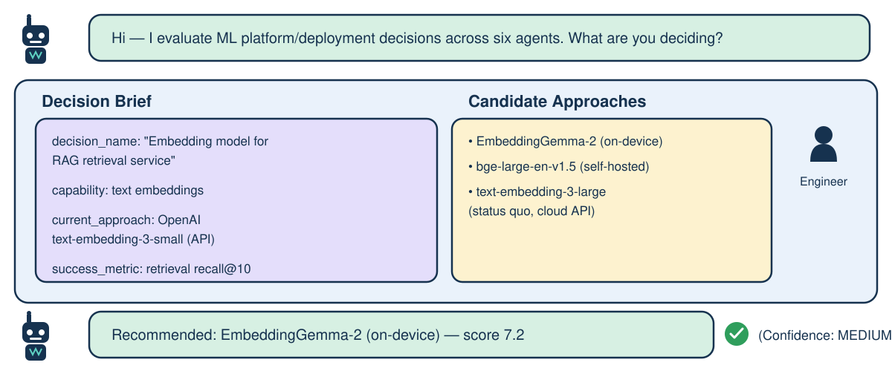

# Multi-Agent Framework for ML Deployment Tradeoff Evaluation

A LangGraph-orchestrated pipeline that evaluates an ML platform/engineering
decision — which model, framework, or serving stack to use for a given
capability — across parallel research agents (landscape, benchmarks, infra
feasibility, cost), synthesizes a scored tradeoff report with a recommended
candidate, and can loop back for deeper research when the evidence is thin.



Two services:

- **`gateway/`** — Rust (Axum), the public edge. Auth, request validation,
  rate limiting. No LLM calls, no LangGraph dependency.
- **`worker/`** — Python (LangGraph + FastAPI), internal-only. Runs the
  actual agent graph.

See the internal design doc (not shipped in this repo) for the full
rationale behind the gateway/worker split, state schema, and deployment
details — this README covers the pipeline shape and how it runs.

## Agent pipeline

Runs inside the worker as a LangGraph `StateGraph`:

```
                         ┌───────────────┐
                         │ orchestrator   │  validates decision_brief;
                         │ (entry node)   │  interrupt() if fields missing
                         └───────┬────────┘
                                 ▼
                          ┌──────────────┐
                          │  agent_1      │   surveys candidate models/
                          │  landscape    │   frameworks/serving options
                          └──────┬───────┘
            ┌────────────────────┼────────────────────┐
            ▼                    ▼                    ▼
      ┌──────────┐        ┌──────────────┐      ┌──────────────┐
      │ agent_2   │        │  agent_3      │      │  agent_4      │
      │ benchmark │        │  infra/       │      │  cost         │
      │           │        │  constraint   │      │  modeling     │
      └────┬──────┘        └──────┬───────┘      └──────┬───────┘
            └────────────────────┼────────────────────┘
                                 ▼
                          ┌──────────────┐
                          │  agent_5      │   migration/rollback/
                          │  integration  │   monitoring plan for the
                          │  strategist   │   leading candidate(s)
                          └──────┬───────┘
                                 ▼
                          ┌──────────────┐
                          │  agent_6      │──────┐
                          │  synthesis     │      │ conditional edge:
                          └──────┬───────┘      │ route_after_synthesis()
                                 │               │
                      confidence ok │               │ weak benchmark/infra/
                      or retries    │               │ cost evidence AND
                      exhausted     ▼               │ retries < MAX_RETRIES
                                 END        back to agent_2/3/4 (whichever
                                             was flagged thin in deepen_research)
```

`agent_1_landscape` runs alone first so Agents 2–4 always have its expanded
candidate list, the same join-ordering rationale the original design used
for build-strategy data. Agents 2–4 (benchmark, infra/constraint, cost
modeling) then run in parallel, join at `agent_5_integration`, and feed
`agent_6_synthesis`. Synthesis is the only node that routes backward — a
conditional edge sends execution back to whichever of Agents 2–4 reported
thin evidence (`deepen_research`), capped by `MAX_RETRIES` so a
genuinely-thin-evidence decision can't loop forever; it just ends with
`confidence_rating: LOW` instead.

A standing monitoring agent (re-check periodically whether a newer/cheaper
candidate has emerged since the recommendation) is a natural follow-on but
isn't built yet — see Status below.

## Deployment

```
                         ┌───────────────────────┐
                         │   Client / scheduler  │   (manual run request,
                         │                       │    or a future monitor)
                         └──────────┬────────────┘
                                    │ HTTPS + x-api-key
                                    ▼
                         ┌───────────────────────┐
                         │      Ingress          │   (public, TLS terminates here)
                         └──────────┬────────────┘
                                    ▼
          ┌─────────────────────────────────────────────┐
          │            gateway  —  Rust / Axum          │
          │  auth (x-api-key) · brief pre-validation ·  │
          │  routes: /runs  /runs/{id}  /resume         │
          └──────────────────────┬──────────────────────┘
                                  │ internal HTTP (ClusterIP — no public DNS)
                                  ▼
          ┌─────────────────────────────────────────────┐
          │           worker  —  Python / FastAPI           │
          │  LangGraph StateGraph (6-agent tradeoff eval)    │
          │  Pydantic structured-output validation per node │
          └───────────┬───────────────────────┬───────────┘
                       │                       │
         checkpoint    │                       │ LLM calls +
         read/write     ▼                       ▼ native web_search
          ┌───────────────────┐       ┌───────────────────┐
          │     Postgres        │       │   Anthropic API     │
          │  (langgraph         │       └───────────────────┘
          │   checkpointer)     │
          └───────────────────┘
                       │
                       │ trace export (per-node, per-agent tags)
                       ▼
             ┌───────────────────┐
             │     LangSmith        │
             └───────────────────┘
```

Everything left of the gateway→worker arrow is public attack surface
(Rust, thin); everything right of it is internal-only and holds every
secret that matters (`ANTHROPIC_API_KEY`, `DATABASE_URL`,
`LANGCHAIN_API_KEY`) — the gateway itself holds no LLM/DB credentials, only
`GATEWAY_API_KEY`.

## Status

The orchestrator and all 6 agent nodes (`worker/src/agents/`), the graph
wiring (`worker/src/graph.py`), and the gateway's auth/validation/proxy
routes (`gateway/src/main.rs`) are written and syntax-checked, not yet
run against live Anthropic/Postgres credentials. In Progress: the
worker's FastAPI wrapper (`worker/src/api.py`), a standing monitoring
agent, and the actual `docker-compose`/k8s deploy of both services
together.

## License

[MIT](./LICENSE)
